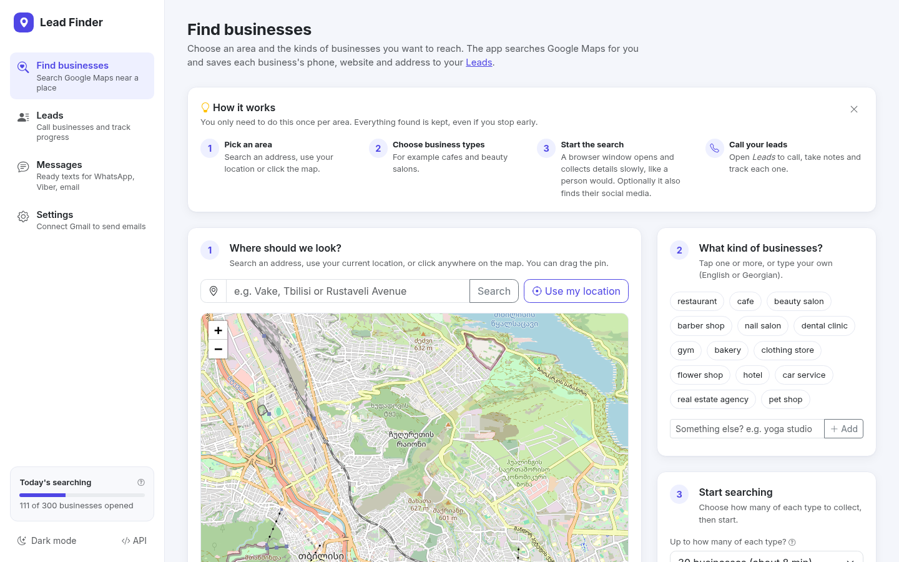
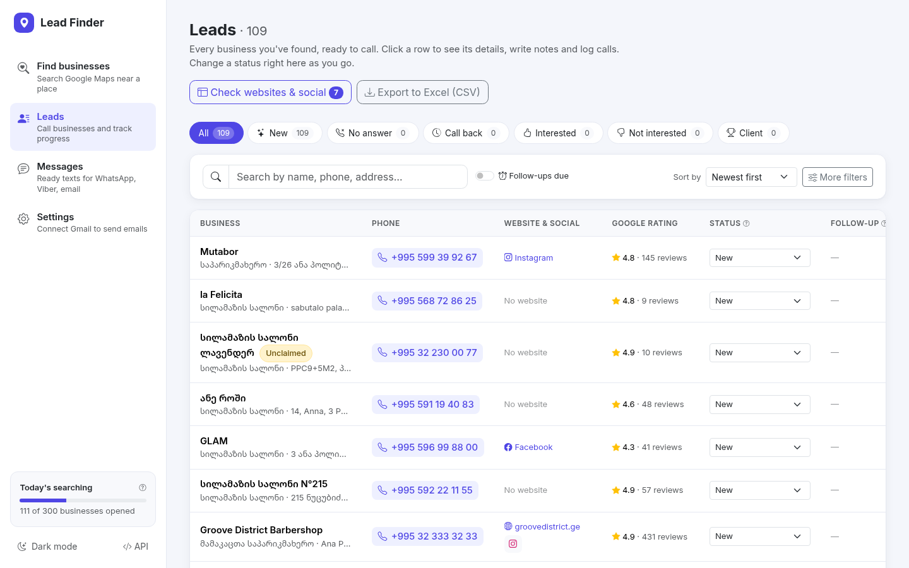
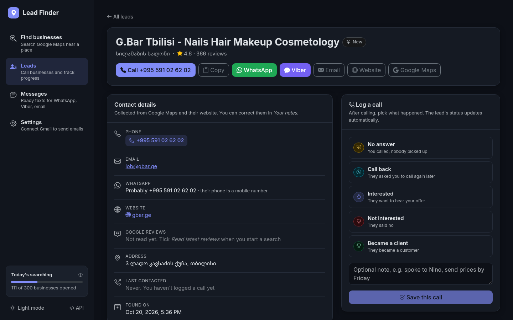

# Business Scraper

A local dashboard for finding businesses on Google Maps near a location and
working through them as sales leads (calling them to offer content creation).

- Pick a point on the map (or use your location), choose categories
  ("beauty salon", "dental clinic", …) and a radius.
- A real browser window searches Google Maps at a person's pace and saves each
  business: name, category, phone, website, address, rating, reviews, opening
  hours, coordinates, Maps link, and whether the listing is unclaimed.
- Optionally checks each business's website (secure? works on phones?
  outdated?) and picks up its Facebook, Instagram and TikTok accounts, email
  and WhatsApp number; optionally reads its latest Google reviews.
- Browse and filter the results, click to call, track lead status, notes,
  follow-up dates and a call log, and export to CSV.
- Message leads on WhatsApp or Viber from ready-made templates, or email them
  straight from the app through your own Gmail.

Built with Flask, Flask-RESTX, SQLAlchemy (SQLite), Playwright and Bootstrap.
Light and dark themes.

| Find businesses | Leads | A lead (dark theme) |
|---|---|---|
|  |  |  |

## Setup

Requires Python 3.10+ and a desktop session (the scraper opens a visible browser window).

```bash
git clone <your-repo-url> BusinessScraper && cd BusinessScraper
python3 -m venv .venv
source .venv/bin/activate          # Windows: .venv\Scripts\activate
pip install -r requirements.txt
playwright install chromium        # one-time browser download
cp .env.example .env               # then set SECRET_KEY to any random string
flask db upgrade                   # creates instance/business_scraper.db
flask run
```

Open http://127.0.0.1:5000. API docs (Swagger) are at http://127.0.0.1:5000/api/docs.

The app has no login: it's meant to run on your own computer and only listens
on 127.0.0.1. Don't expose it to a network as-is.

Everything personal stays in the git-ignored `instance/` folder: the database,
the browser profile (your Google cookies), logs, and your Gmail App Password.

## Using it

1. **Search page** – choose a location, add one or more categories, set the
   radius and how many businesses per category, then *Start search*. Each
   category becomes its own search; they run one after another.
2. A Chromium window opens and works on its own. **Leave it alone.** If Google
   shows a CAPTCHA, solve it in that window; the search continues afterwards.
3. *Recent searches* shows live progress. *Results* opens that search's businesses.
4. **Leads page** – filter (status, category, has phone/website/email,
   unclaimed, social media, website quality, rating, follow-up due), change
   status inline, export the current view to CSV.
5. **Lead page** – call, message, write notes, set a follow-up date, log each
   call (logging a call sets the lead status to its outcome).
6. **Messages** – edit the WhatsApp / Viber / email templates.
7. **Settings** – connect your Gmail to send emails from the app.

Tip: *Google listing → Unclaimed* finds businesses nobody manages online,
often the best prospects for content creation.

## Website check & social media lookup

Tick *Check their website and find Facebook, Instagram, TikTok* before starting
a search. After the Google Maps part finishes and the browser closes, each new
business is checked:

1. If the "website" on its Google listing is itself a social profile, that's
   saved (and the lead is marked as having no real website).
2. Otherwise its own website is downloaded (plain HTTP, no browser). From it
   the app saves the Facebook / Instagram / TikTok links, a contact email
   (mailto links and the site's own domain preferred, job/career addresses
   last) and a WhatsApp number (wa.me links). If something is missing, up to
   two Contact/About pages on the same site are checked too.
3. The homepage is graded: HTTPS, works on phones (viewport tag), load time
   (over 4 s is slow), the © year in the footer (two or more years old looks
   outdated) and the site builder if recognisable. Problems show on the lead
   page as talking points and as a badge on the Leads page.

Share buttons, website-builder accounts and links to posts are ignored; one
account per platform is kept (the one the site links to most). Google and the
social sites themselves are never contacted, so this can't get you blocked.
Businesses without a website end up as "no website to look at"; add accounts
by hand on the lead page.

For leads found earlier, use *Check websites & social* on the Leads page
(checks every lead not checked yet, including older ones whose website was
never graded) or *Check website* / *Find accounts* on a lead's page. Useful
filters: *Social media → No social media found*, *Website quality → Has
problems*, *Email → Has an email*. Changing a lead's website resets it to
"not checked".

## Google reviews

Tick *Read latest Google reviews* to also open each business's Reviews tab,
sort by newest and read the first 5: the lead page then shows how long ago the
newest review was and how many of those the owner replied to. Adds about 8 s
per business. Google's panel doesn't show a photo count, so that isn't
collected; the price level (e.g. ₾₾) is saved when Google shows one.

## Messaging (WhatsApp, Viber, email)

Leads with a Georgian mobile number (+995 5…) or a WhatsApp number from their
website get *WhatsApp* and *Viber* buttons; leads with an email get *Email*.
Each opens a dialog where you pick a template, adjust the text and open the
app with it ready to send. WhatsApp is pre-filled; Viber can't be, so the text
is copied for you to paste. Edit templates on the *Messages* page; `{name}` and
`{category}` are filled in per lead. Nothing is sent without you clicking Send.

### Sending email from the app

On **Settings**, enter your Gmail address and a Gmail **App Password**:

1. Turn on 2-Step Verification for your Google account.
2. Open <https://myaccount.google.com/apppasswords>, name it "Lead Finder",
   click *Create* and copy the 16-letter password.
3. Paste it on Settings and click *Connect Gmail* (the app signs in once to
   check it). *Send me a test email* confirms it works.

Your normal Gmail password won't work; Google only allows App Passwords for
apps like this. Once connected, the *Email* button sends directly through
Gmail's SMTP server (`smtp.gmail.com:465`), the email shows up in your Gmail
*Sent* folder, and it's listed in the lead's history. Without Gmail connected,
the button opens your email app instead. The address and App Password are
stored in `instance/mail_settings.json` (readable only by your user, never
returned by the API); *Disconnect* deletes it. Gmail allows about 500 emails a
day; send them one at a time, as personal messages, or they'll end up in spam.

## How the scraper avoids getting blocked

It behaves like one patient person rather than trying to hide:

- A visible browser with a persistent profile (`instance/browser_profile`), so
  Google sees a returning visitor; Georgian locale and Tbilisi timezone.
- Types the query into the search box, moves the mouse before clicking,
  scrolls in small uneven flicks, and spends 4–9 s on each business.
- A 25–70 s break every 12–20 businesses, at least 90 s between searches,
  and at most 300 businesses opened per day.
- Results outside the radius are skipped without being opened.
- On a CAPTCHA it waits up to 5 minutes for you to solve it. If you don't, it
  saves what it found and pauses all searches for 6 hours (shown in the top bar).

No scraper is guaranteed undetectable, and automated access is against Google's
terms of service. Keep searches modest. Installing Google Chrome and setting
`SCRAPER_BROWSER_CHANNEL=chrome` makes the browser look more ordinary.

## Configuration

All settings live in `.env` (see `.env.example`). The most useful:

| Setting | Default | Meaning |
|---|---|---|
| `SCRAPER_PROVIDER` | `google_maps` | `fake` generates sample data for development |
| `SCRAPER_HEADLESS` | `false` | Hide the browser window (riskier, and you can't solve CAPTCHAs) |
| `SCRAPER_BROWSER_CHANNEL` | bundled Chromium | `chrome` to use installed Google Chrome |
| `SCRAPER_PLACE_DELAY_MIN` / `_MAX` | `4` / `9` | Seconds spent on each business |
| `SCRAPER_SEARCH_COOLDOWN` | `90` | Minimum seconds between searches |
| `SCRAPER_DAILY_PLACE_LIMIT` | `300` | Businesses opened per day |
| `SCRAPER_CAPTCHA_WAIT` | `300` | Seconds to wait for you to solve a CAPTCHA |
| `SCRAPER_BLOCK_BACKOFF_HOURS` | `6` | Pause after an unsolved CAPTCHA |
| `SCRAPER_LANGUAGE` | `ka` | Google Maps interface language |
| `SOCIAL_PAGE_DELAY_MIN` / `_MAX` | `1.5` / `4` | Seconds between website downloads in the social lookup |
| `SOCIAL_FETCH_TIMEOUT` | `8` | Seconds to wait for a business's website |
| `GEOCODER_USER_AGENT` | – | Put your email here (OpenStreetMap's usage policy) |
| `MAIL_SMTP_HOST` / `_PORT` | `smtp.gmail.com` / `465` | SMTP-over-SSL server for sending email |

Pacing state (daily count, cooldown, CAPTCHA pause) is kept in
`instance/scraper_state.json`. Delete the `blocked_until` line there to lift a
pause early.

## Troubleshooting

- **A search failed with "Interrupted: the server stopped…"** – the server
  restarted while it was running (for example a code change with
  `FLASK_DEBUG=1`, or Ctrl+C). Businesses found before that are saved; start
  the search again.
- **"Google Maps may have changed its page layout"** – several businesses in a
  row couldn't be read. Selectors in `app/services/scrapers/google_maps.py`
  likely need updating.
- **"The browser window was closed during the search"** – the Chromium window
  was closed by hand. Results so far are saved.
- **"Gmail didn't accept that password"** – use an App Password (see *Sending
  email from the app*), not your normal password. If App passwords is missing
  in your Google account, 2-Step Verification isn't on yet, or your work/school
  admin has disabled it.
- Logs are written to `instance/logs/app.log`.

## Development

```bash
pip install -r requirements-dev.txt
pytest                       # tests use an in-memory database and the fake scraper; nothing is sent or scraped
flask db migrate -m "..."    # after changing models
flask db upgrade
```

GitHub Actions runs the tests on every push (`.github/workflows/tests.yml`).

```
app/
  api/              Flask-RESTX namespaces: businesses, searches, templates, mail, geocode, health
  models/           Business, SearchJob, CallLog, SocialProfile, MessageTemplate, SentEmail
  services/
    businesses.py   upsert (dedupe by Google place id), filtering, stats, CSV
    socials.py      finding social accounts from the listing and the business's website
    website_info.py email / WhatsApp extraction and the website quality check
    templates.py    message templates
    mailer.py       sending email through your Gmail (SMTP + App Password)
    searches.py     validating and cancelling search jobs
    geocoding.py    OpenStreetMap Nominatim lookups
    scrapers/       google_maps.py, human.py (pacing/input), pacing.py (limits), fake.py
  workers/runner.py background search jobs
  web/              dashboard pages (Jinja + Bootstrap + Leaflet + vanilla JS)
migrations/         Alembic migrations
tests/
docs/screenshots/   images used in this README
instance/           local data, git-ignored (created on first run)
```
